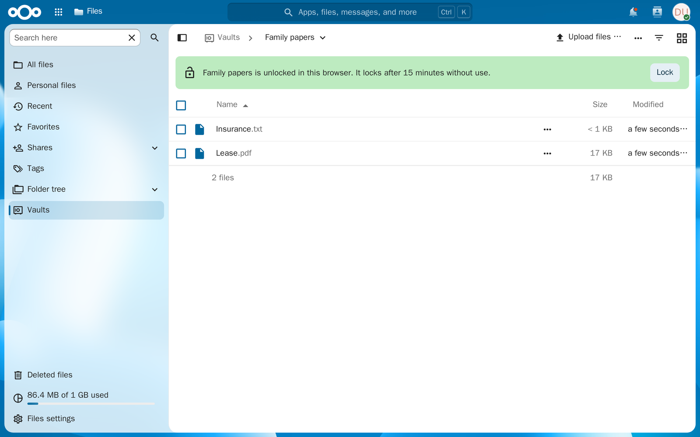
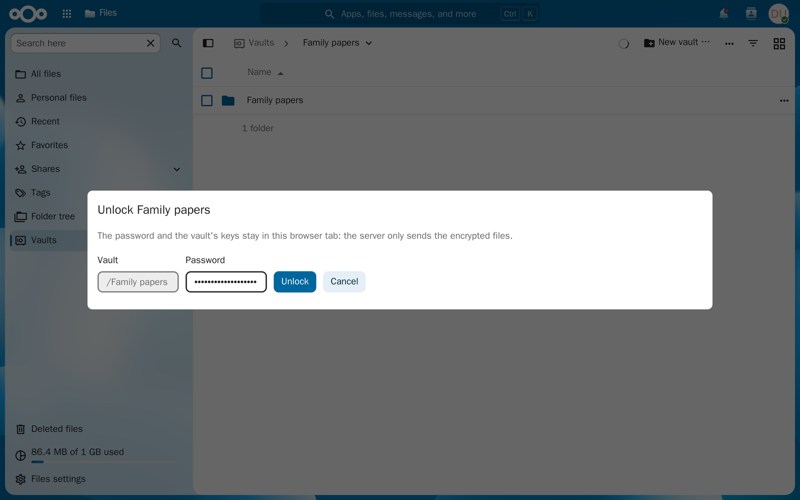
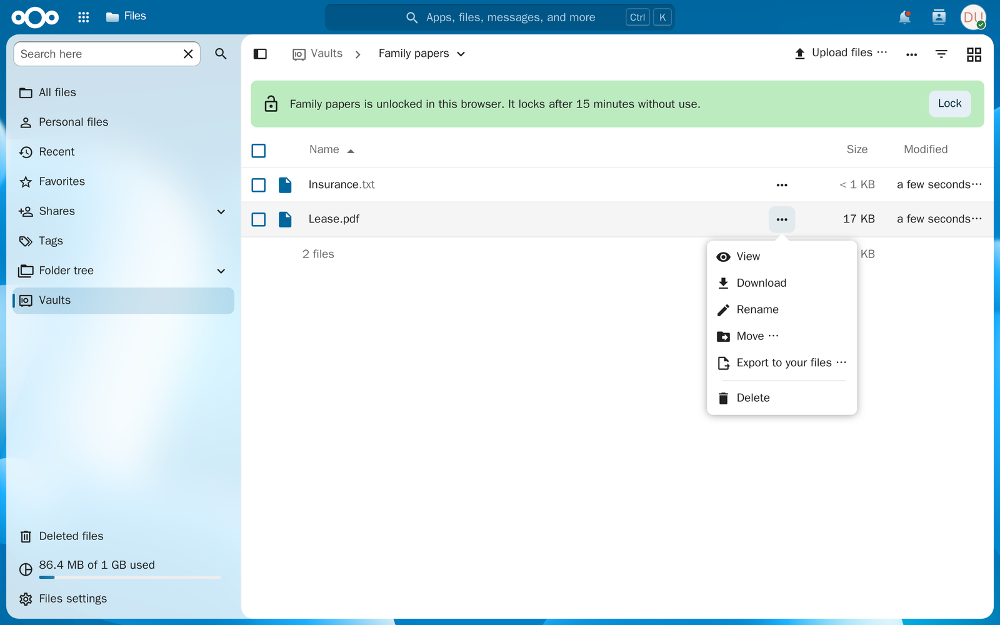
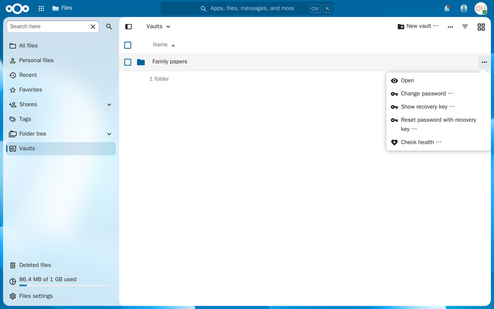

# Vaults for Cryptomator

Browse the [Cryptomator](https://cryptomator.org/) vaults you keep in Nextcloud in the Files
app: open their folders, preview, download and upload files, without installing Cryptomator.

- **In Files:** *Vaults* in the navigation lists your vaults. An unlocked vault shows in Files' own
  list, with its folders, breadcrumbs, sorting and grid view.
- **Recognised as you open it:** when you open a vault's folder in your files, a notice above the
  list offers to open the vault.
- **Unlocked in your browser:** the password, the vault's keys and every decrypted name and file
  stay in the browser tab. The server only sends the encrypted files, as it does when Cryptomator
  itself reads the vault.
- **Locks itself** after 15 minutes without use, when you choose **Lock** (in the bar above an
  open vault's list), and when you leave the page.
- **Upload files and folders, new folders, rename, move, delete:** files are encrypted in your
  browser and written exactly as Cryptomator writes them, each checked before it enters the vault;
  the vault stays readable by Cryptomator at every step. Large files go in pieces, so the browser
  never holds a whole file of gigabytes.
- **Previews** of pictures, PDFs, text, audio, video, Word documents (docx) and spreadsheets (xlsx,
  xls, ods), all made in the browser.

Not affiliated with Skymatic GmbH, the makers of Cryptomator.

## Screenshots

|                                                                          |                                                           |
| ------------------------------------------------------------------------ | --------------------------------------------------------- |
|  |             |
|               |  |

## Requirements

- Nextcloud 32 to 36, reached over **HTTPS**: browsers offer their encryption (Web Crypto) only
  on secure pages.
- Vaults of **vault format 8** (Cryptomator 1.6 and later), with either cipher combination
  (`SIV_GCM`, the default, or `SIV_CTRMAC`). Older vaults: open them once in a current
  Cryptomator, which offers to upgrade them. Vaults whose key is on a Cryptomator Hub are not
  supported.

## Installing

Unpack a release's `cryptomator_vaults-X.Y.Z.tar.gz` into `custom_apps/` and run
`occ app:enable cryptomator_vaults`. Files gets *Vaults* in its navigation; *Vaults* in the app
menu leads there.

## Using it

1. Open a vault, in one of these ways:
    - *Vaults* in Files' navigation lists the folders of your files that hold a vault
      (`vault.cryptomator`). Choose one.
    - Open a vault's folder in your files: the notice above the list has **Open vault**. So has
      the menu of the folder and of its `vault.cryptomator`; this also works for a vault in a share.
    - **Open a vault folder …** at the top of *Vaults* chooses one with Nextcloud's file picker.
2. Enter the vault's password. Beside it, the vault's folder stands as the user name, so that a
   password manager offers and saves an entry per vault. An entry Cryptomator's phone app saved has
   the app as its address (e.g. `androidapp://org.cryptomator`), which a browser never matches: add
   the site to it, e.g. `https://<your cloud>/apps/files/cryptomator-vaults` (match: starts with),
   with the vault's folder as its user name.
3. Browse it like any folder in Files. Choose a file to preview it (pictures, PDFs, text, audio,
   video, Markdown, ZIP archives, HEIC photos, Word, PowerPoint and OpenDocument documents and
   spreadsheets up to 100 MB); its menu has **Download**. A large file
   without a preview goes straight to your computer: Edge and Chrome ask where to save it and
   write it in pieces as it is decrypted, other browsers hold it in memory first.
4. To add files, choose **Upload files …** or **Upload folder …** at the top, or drop files and
   folders on the list; **New folder …** creates a folder. A folder of a name that is there
   already gets the new files; if a file of that name exists, you're asked whether to replace it.
   An entry's menu has **Rename**, **Move …** (to a folder of the vault) and **Delete**; select
   several to move or delete them together.
5. To bring files and folders of yours into the vault, choose **Add from your files …** at the
   top and then **Copy into the vault** or **Move into the vault**. To take entries out of it,
   decrypted, choose **Export to your files …** in their menu, a folder, and **Copy here** or
   **Move here**.
6. **New vault …** at the top of *Vaults* creates a vault in a folder you choose (as Cryptomator's
   desktop app does: vault format 8, AES-GCM), opens it and shows its recovery key. A vault's
   menu in *Vaults* has **Change password …**, **Show recovery key …**, **Reset password with
   recovery key …** and **Check health …**.
7. Choose **Lock** in the bar above an open vault, in the vault's menu in *Vaults*, or **Lock all
   vaults** at the top.

Files from 16 MB are encrypted, uploaded and checked in parts of 10 MB, so memory holds a part,
not the file. Downloading a large file in pieces needs a browser that lets a page save a file so
(Edge, Chrome); others hold the file in memory, and above 1 GB the app asks first.

Moving a file or folder into the vault deletes the original once all of it is in the vault and
checked, and only if it did not change meanwhile (its ETag: `If-Match` for a file; a folder's,
which changes with anything inside it, is compared just before, as Nextcloud refuses `If-Match` on
folders). It is also removed from Nextcloud's deleted files, with its versions, so that no
unencrypted copy stays on the server. What is shared with you is copied, never deleted: deleting
it would take it from its owner. A folder that holds a vault cannot go into one.

An export writes the decrypted file into your files and checks it: read back and compared (a large
one in parts of 10 MB, each against its SHA-256). Moving out removes an entry from the vault only
once all of it was exported; links, and what does not decrypt, stay in the vault, and so does
their folder. An export is the one way the app hands the server decrypted files, as you ask it to.

Vault maintenance works as in Cryptomator, and with it:

- **New vault:** new keys in the browser, the key file (`masterkey.cryptomator`, scrypt with
  Cryptomator's settings), the configuration (`vault.cryptomator`) and the root directory with
  its ID's backup; opened again from the server and unlocked before it is shown.
- **Password:** the keys unwrapped with the old password and wrapped with the new one (a new salt);
  the old key file kept beside as `masterkey.cryptomator.<hash>.bkup`, as Cryptomator keeps it.
  The new file is read back and must give the same keys, else the old one is put back. The files
  are not touched; Cryptomator on other devices needs the new password.
- **Recovery key:** the 44 words Cryptomator's desktop app shows (its word list, the keys and a
  check sum), so that a key made here works in Cryptomator and the other way round. A new password
  set with it is refused unless the vault's configuration is signed with the key's keys; it also
  makes a lost key file anew.
- **Health check:** cryptofs' checks (directory IDs, shortened names, entry types), its findings
  by its names and severities, and the repairs it offers, the rescue of orphaned entries into
  `/LOST+FOUND` among them. The other findings are shown, left to Cryptomator or a backup.

A sync client that finds a file changed on both sides keeps a copy beside it (e.g.
`… (conflicted copy …).c9r`). The app resolves such copies as Cryptomator does when it lists the
folder: it gives a copy its proper name if that is free, deletes a duplicate of a folder or link,
and otherwise renames the copy so that both files show.

## How it works

The server only serves the app's scripts. Everything else runs in the browser:

1. It reads the vault's files over WebDAV, as the Files app does, with your Nextcloud login.
2. `js/vault.js` derives the key from your password (scrypt) and unwraps the vault's two keys
   with it. It checks that the configuration `vault.cryptomator` is signed with them, then keeps
   them as keys the browser won't export.
3. It decrypts names (AES-SIV) and contents (AES-GCM, or AES-CTR with HMAC), and checks that
   each part is authentic: a changed byte is reported, not shown.
4. `src/files.js` hands the decrypted folders to Files as a view of its own.

Files would ask the server for some things about what it shows, so the integration keeps it from
that:

- The vault's entries have addresses that are never requested and name nothing (hashes), and are
  not WebDAV files: Files' own actions that would reach the server (download, details, rename,
  move, favourite, open in the desktop client) are not offered for them. Other apps' actions are
  switched off in *Vaults* as well; the app's own **View**, **Download** and **Lock** take their
  place.
- A folder's URL (`?dir=/v…/d…`), which a reload sends to the server, holds only those hashes; the
  breadcrumbs show the names.
- Every file shows the same icon: Files would fetch each file type's icon from the server and tell
  it each file's type.
- Locking also removes the vault's entries from Files' memory.

### Writing without harming the vault

A vault must stay readable by Cryptomator at every moment, also if the browser or the connection
dies midway. `js/vault.js` writes as Cryptomator does (names, long names as `.c9s`, a folder's ID
and its `dirid.c9r`, headers and chunks) and in this order:

1. The encryption is undone in memory and compared before anything is stored.
2. A file is written under a staging name in the vault's top folder, which Cryptomator passes by
   (also its health checks, which look at `d/`).
3. It is read back from the server and compared (SHA-256 of the decrypted contents).
4. Only then is it moved into place, in one step: refused if the name was taken meanwhile, and
   over the old file only when replacing was chosen. A failed check leaves the vault as it was.

If the browser is closed midway, the staging file stays behind (Cryptomator passes it by). When the
vault is next unlocked, staging files and folders older than a day are removed; younger ones may
belong to a write still going on in another tab or on another device.

An entry of several files (a new folder's `dir.c9r`, a long name's `name.c9s`) is put together in a
staging folder and moved into place the same way. A new folder's own directory, with its
`dirid.c9r`, exists before the entry that points to it. Nothing is ever replaced by a folder, nor a
folder by a file. Nextcloud keeps the replaced file's encrypted version (*Versions*), and Cryptomator
can open such an old version.

### Renaming, moving and deleting

A file's contents are not bound to its name or folder, and a folder's entries live under its ID,
not its name: renaming or moving changes the entry alone, whatever is in it.

- Between two short names it is one move on the server, refused if the new name is taken.
- Where a long name (`.c9s`) is involved on either side, the new entry is put together under a
  staging name (the file's contents copied on the server and checked), moved into place, and only
  then is the old one removed: a crash leaves both, never neither.
- A folder cannot be moved into itself or a folder inside it (the folder chooser offers neither).
- Deleting a folder removes its entry first, so that everything in it disappears at once, then the
  directories of the folder and of every folder below it. Everything deleted goes to Nextcloud's
  deleted files, encrypted.

What this protects against, and what it doesn't:

- **It keeps** Cryptomator's promise that the server never sees your files, their names or your
  password. The browser test checks every request for them.
- **It doesn't protect against a server that's been taken over:** such a server could send changed
  scripts that send the password elsewhere. That is true of every web page that encrypts in the
  browser. If you don't trust the server, use Cryptomator's own apps.
- **On the device,** decrypted files exist while the vault is unlocked: as previews and as
  downloads, which stay in your downloads folder. Locking drops the keys and the previews.

Decrypted files are shown so that they can't act as you in Nextcloud: HTML only as text, SVG only
as a picture, and downloads typed as plain data, which no browser renders. Word documents and
spreadsheets are rendered in the browser (Collabora would need the file on the server) into a
frame with neither scripts nor an origin of its own, whose page loads nothing from outside; links
and outside addresses are removed from it.

## Developing

```bash
npm ci
npm run build                     # src/ into app/cryptomator_vaults/js and css (committed)
npm test                          # decryption, writing, translations
npm run test:compat               # what the app writes, read by Cryptomator's library
```

The build is committed, because servers install the app from the repository without building it;
CI checks that it is what `src/` builds. The integration uses `@nextcloud/files` (Files' view and
actions) and loads `@nextcloud/dialogs` (toasts, the file picker, with Vue) only when first needed,
so that Files loads about 50 KB more (gzipped), not 350 KB.

CI (`.forgejo/workflows/ci.yml`) also lints the PHP, checks it with php-cs-fixer and Psalm,
checks `appinfo/info.xml` against the app store's schema and the Markdown with markdownlint.

The PHP follows Nextcloud's coding standard and is checked by Psalm against Nextcloud's public
API (`nextcloud/ocp`); composer holds only these tools, the app needs none:

```bash
composer install
composer cs:check                 # composer cs:fix to reformat
composer psalm
npx --yes markdownlint-cli2 "*.md" "docs/**/*.md"
```

What the tests cover, and how to release: [developer's guide](docs/developer.md).

## Reporting problems

Open an issue on Forgejo,
[dawid/nextcloud-cryptomator](https://git.ciepiela.org/dawid/nextcloud-cryptomator/issues), or on
its GitHub mirror, [sarumaj/nextcloud-cryptomator](https://github.com/sarumaj/nextcloud-cryptomator/issues).
Security problems privately, as [SECURITY.md](SECURITY.md) describes.

## Licence

[AGPL-3.0-or-later](LICENSE). The third-party packages in the build and their licences are listed
in [NOTICE.md](NOTICE.md) (`npm run notice`).
